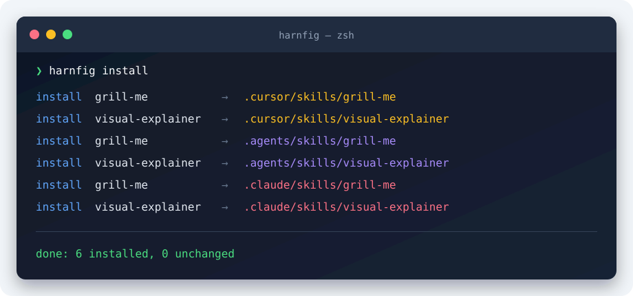

# harnfig

[](https://github.com/pfedotovsky/harnfig/actions/workflows/ci.yml)
[](https://www.nuget.org/packages/harnfig)
[](https://github.com/pfedotovsky/harnfig/releases/latest)
[](LICENSE)

**Install the same [Agent Skills](https://agentskills.io) for Cursor, Codex, and Claude from one YAML file.**

One manifest, one lockfile, one command:

```text
harnfig.yaml ── harnfig install ──┬── .cursor/skills
                                  ├── .agents/skills
                                  └── .claude/skills
```

Harnfig installs Agent Skills directly from GitHub, pins them to commits, and keeps every selected agent in sync.



## Quick start

Install Harnfig as a .NET tool (requires the [.NET 10 SDK](https://dotnet.microsoft.com/download/dotnet/10.0)):

```bash
dotnet tool install --global harnfig
```

Create `harnfig.yaml` in your repository:

```yaml
version: 1
scope: project

agents:
  - cursor
  - codex
  - claude

skills:
  - repo: mattpocock/skills
    path: skills/productivity/grill-me
    ref: main
```

Then install the skill for every selected agent:

```bash
harnfig install
```

Commit `harnfig.yaml` and the generated `harnfig.lock`. Anyone cloning the repository can now reproduce the same skill setup.

## What you get

- **One source of truth.** Declare skills once instead of configuring each agent separately.
- **Reproducible installs.** Git refs resolve to commits and content digests are recorded in `harnfig.lock`.
- **Safe updates.** Existing unmanaged or locally modified skills stay untouched unless you pass `--force`.
- **Atomic multi-agent writes.** Changes are staged and rolled back together if installation fails.
- **Private repository support.** Harnfig uses your existing Git credential helper or SSH agent and never stores tokens.

## Configuration

Each skill points to a directory in a GitHub repository:

```yaml
skills:
  - repo: nicobailon/visual-explainer
    path: plugins/visual-explainer
    ref: main
```

`repo` is the GitHub repository. `path` is the directory containing the skill's `SKILL.md`; use `path: .` when the repository root is the skill. `ref` can be a branch, tag, or commit.

Set `scope` to `project` to install beside the configuration file or `user` to install in the current user's agent directories. See the complete [example manifest](examples/harnfig.yaml) and its generated [lockfile](examples/harnfig.lock).

## Commands

```text
harnfig install [--config <path>] [--scope project|user]
                [--dry-run] [--frozen] [--update] [--force]
harnfig version
harnfig help
```

- `--dry-run` resolves and validates without writing.
- `--frozen` requires the lockfile to match exactly.
- `--update` refreshes mutable refs.
- `--force` replaces unmanaged or locally modified destinations.

Project installations are relative to `harnfig.yaml`:

| Agent | Project | User |
|---|---|---|
| Cursor | `.cursor/skills/<name>` | `~/.cursor/skills/<name>` |
| Codex | `.agents/skills/<name>` | `~/.agents/skills/<name>` |
| Claude | `.claude/skills/<name>` | `~/.claude/skills/<name>` |

## Safety model

- Downloaded scripts, hooks, and commands are never executed during installation.
- Repository paths cannot escape the checkout.
- Symlinks and special filesystem entries are rejected in v0.1.
- Existing unmanaged or locally changed skills are not overwritten without `--force`.
- Multi-target writes are staged and rolled back if the transaction fails.
- The installed skill is copied unchanged, including its own license.

## Installation alternatives

Choose the channel that fits your environment:

| Channel | Command or download | Runtime required |
|---|---|---|
| .NET global tool | `dotnet tool install --global harnfig` | .NET 10 SDK |
| One-off .NET execution | `dotnet tool exec harnfig -- install` | .NET 10 SDK |
| Homebrew | `brew install pfedotovsky/tap/harnfig` | None |
| Scoop | See the Windows commands below | None |
| Native executable | [Download from GitHub Releases](https://github.com/pfedotovsky/harnfig/releases/latest) | None |

All five channels are published and verified. NativeAOT archives are available for macOS, Linux, and Windows across six platforms.

### Homebrew

With [Homebrew](https://brew.sh/) installed on macOS or Linux:

```bash
brew install pfedotovsky/tap/harnfig
harnfig version
```

The formula is published in [`pfedotovsky/homebrew-tap`](https://github.com/pfedotovsky/homebrew-tap).

### Scoop

With [Scoop](https://scoop.sh/) installed on Windows:

```powershell
scoop bucket add pfedotovsky https://github.com/pfedotovsky/scoop-bucket
scoop install harnfig
harnfig version
```

The manifest is published in [`pfedotovsky/scoop-bucket`](https://github.com/pfedotovsky/scoop-bucket).

### .NET tool setup

On Linux and macOS, the .NET installer may ask you to add the global tools directory to `PATH`:

```bash
export PATH="$HOME/.dotnet/tools:$PATH"
```

Put it before the existing `PATH` so `harnfig` wins if another executable with the same name is already installed. Check with `command -v harnfig`.

When .NET itself was installed through Homebrew, also set:

```bash
export DOTNET_ROOT="$(brew --prefix dotnet)/libexec"
```

## Why Harnfig?

[gaal](https://github.com/getgaal/gaal) solves a broader version of this problem: skills, MCP servers, repositories, content, and hooks. [Vercel skills](https://github.com/vercel-labs/skills), [`gh skill`](https://cli.github.com/manual/gh_skill), and [OpenSkills](https://github.com/numman-ali/openskills) are useful alternatives too.

Harnfig is deliberately narrower. It installs skills from GitHub without trying to manage every part of an agent harness. The useful core remains small enough to read, explain, and change: parse one file, resolve Git commits, validate `SKILL.md`, and copy directories safely.

That also makes Harnfig a compact .NET teaching project. See the [60-second talk demo](docs/demo.md), [alternatives](docs/alternatives.md), and [architecture](docs/architecture.md) for more context.

## Development

Requires the .NET 10 SDK and Git.

```bash
dotnet restore Harnfig.slnx
dotnet build Harnfig.slnx --no-restore
dotnet test Harnfig.slnx --no-build

# NativeAOT on macOS with Homebrew dependencies
LIBRARY_PATH="$(brew --prefix openssl@3)/lib:$(brew --prefix brotli)/lib" \
  dotnet publish src/Harnfig/Harnfig.csproj -c Release -r osx-arm64
```

The release workflow builds all six runtime identifiers on native GitHub-hosted runners.

The code is licensed under [Apache-2.0](LICENSE). Downloaded skills retain their original licenses.
